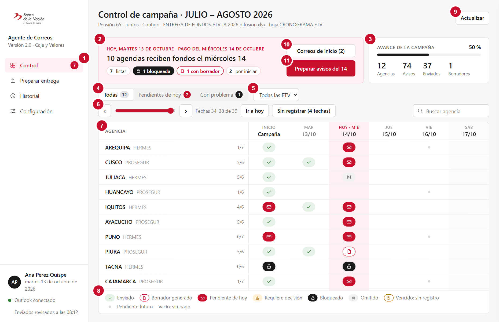
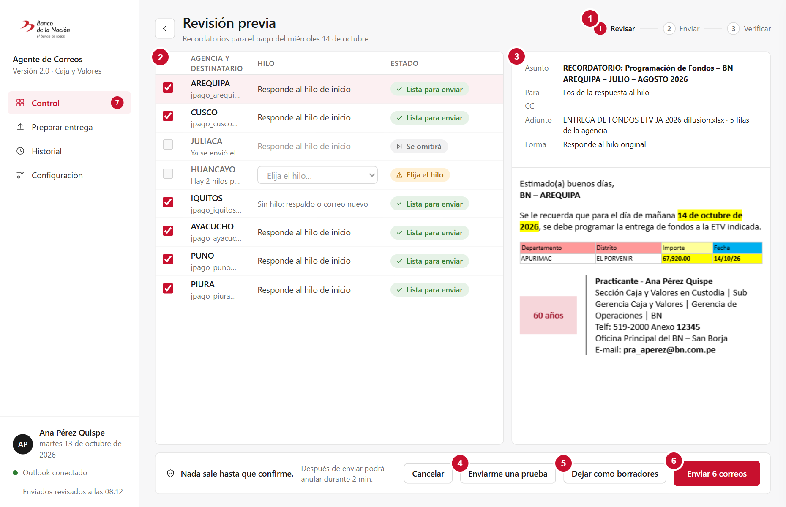
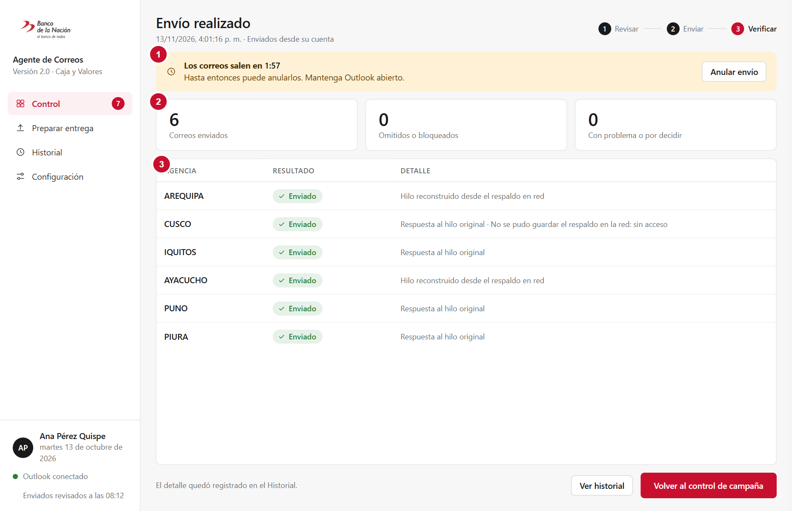
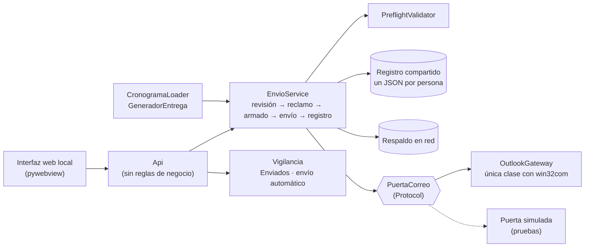

# Agente de Correos BN

**Aplicación de escritorio que prepara y envía los avisos de entrega de fondos a las agencias del Banco de la Nación, con una persona que decide cada envío.**

> Proyecto desarrollado para el **Banco de la Nación del Perú** (Caja y Valores, Gerencia de Operaciones) para el proceso de pago de los Programas Sociales. Este repositorio **no contiene datos reales del banco**: los correos, nombres, rutas de red y cronogramas de las pruebas y capturas son ficticios. Los valores propios de la institución se cargan desde un archivo local que el repositorio ignora (ver [Valores de cada despliegue](#valores-de-cada-despliegue)).

| | |
|---|---|
| Versión | 2.1.1-beta |
| Tecnología | Python 3.10+ · pandas · openpyxl · Outlook por COM (pywin32) · interfaz web local con pywebview |
| Pruebas | 256 automáticas (`python -m pytest`), con Outlook simulado |
| Plataforma | Windows con Outlook de escritorio (como en las PC del banco) |



## El problema

Cada campaña bimestral, el banco paga a los beneficiarios de Pensión 65, Juntos y Contigo a través de empresas transportadoras de valores (ETV). Para que los fondos lleguen a tiempo, **cada agencia debe recibir por correo su cronograma de entregas**: un correo de inicio de campaña y un recordatorio por cada fecha de pago (unas 34 fechas y 17–18 agencias por campaña).

Hacerlo a mano implica filtrar un Excel por agencia, armar la tabla del correo, adjuntar el archivo correcto, buscar el hilo original para responder y no repetir ni olvidar ningún aviso. Un error —un adjunto con filas de otra agencia, un recordatorio duplicado, una fecha omitida— llega al personal de la agencia.

## Qué hace

- **Tablero de control de la campaña** (agencias × fechas de pago): qué avisos salieron, cuáles tocan hoy, cuáles están bloqueados o vencidos.
- **Correo de inicio y recordatorios** con la tabla HTML y el Excel filtrado de cada agencia. El recordatorio responde en el hilo del inicio; si ese hilo no está en el Outlook de la persona, lo reconstruye desde un respaldo en la red.
- **Prepara el archivo de entrega** a partir del cronograma original (que nunca se modifica): quita los puntos suspendidos y reprograma fechas, con bitácora de cada cambio y su origen.
- **Revisión previa** antes de tocar Outlook: bloquea la agencia sin correo o con correo inválido, omite lo ya enviado y pide decisión cuando hay dos hilos posibles. Nunca adivina.
- **Una persona decide cada envío**: confirmación con la lista a la vista, «Enviarme una prueba», «Dejar como borradores» y una **ventana para anular** (entrega diferida de Outlook).
- **Anti doble envío entre personas**: un registro compartido con un archivo JSON por persona y campaña, y un protocolo de *reclamo* previo al envío. Si dos personas preparan el mismo aviso, solo sale uno.
- **Firma por usuario** generada con el formato institucional; identidad = cuenta de Windows, sin login propio.
- **Revisa la carpeta Enviados** (solo lectura) y anota los avisos que salieron por fuera del programa.
- **Envío automático supervisado** (opcional, apagado de fábrica): a la hora elegida prepara los recordatorios del día y los envía tras una cuenta regresiva que se puede cancelar; solo salen los que pasan la revisión sin advertencias.
- **Todo editable y auditable**: correos de las agencias, jefatura, copia fija, feriados y rutas, con historial de quién cambió qué.
- **Instalador** `.exe` sin permisos de administrador y exportación de un diagnóstico sin datos de las agencias.

| Revisión previa | Resultado con anulación |
|---|---|
|  |  |

## Diseño

El principio es que **la lógica del negocio no sabe que existe Outlook**. Solo una clase habla con él; todo lo demás se prueba contra una puerta simulada.



| Paquete | Responsabilidad |
|---|---|
| `agente_correos/dominio` | Campaña, aviso, estados y claves (sin dependencias) |
| `agente_correos/datos` | Lectura flexible del cronograma, generación de la entrega, directorio de agencias editable |
| `agente_correos/reglas` | Calendario hábil (víspera, viernes → lunes, feriados) y revisión previa |
| `agente_correos/contenido` | Asuntos, cuerpos, tabla HTML y firma |
| `agente_correos/correo` | Armado del correo, búsqueda del hilo, respaldo en red y `OutlookGateway` |
| `agente_correos/historial` | Registro compartido con reclamo anti doble envío |
| `agente_correos/servicios` | Orquestación del envío y revisión de Enviados |
| `agente_correos/ui` | `Api` para pywebview, vigilancia en segundo plano e interfaz (HTML/CSS/JS sin librerías externas) |

Decisiones que vale la pena mirar (el razonamiento completo está en [`docs/proyecto.md`](docs/proyecto.md)):

- **Registro como archivos, no como base de datos.** Se midió el SharePoint del banco (crear un archivo ≈ 0,9 s, renombrar ≈ 2,7 s, leer ≈ 0,2 s) y SQLite sobre una carpeta de red no es seguro. Cada persona escribe un único archivo por campaña y nadie más lo toca.
- **El original es de solo lectura.** Todo cambio se hace en una copia con bitácora.
- **Humano en el bucle.** Antes de esta versión existió un flujo de envío desatendido que se descartó por los problemas que causó; el modo automático actual es opcional, supervisado y nunca envía el correo de inicio.
- **Reescritura con paridad.** La v1 ([`legacy/v1`](legacy/v1)) era una sola clase de 2.780 líneas. La v2 la reemplaza y una prueba automática verifica que genera el mismo HTML.

## Estado y validación

Se separa lo comprobado de lo pendiente, porque parte del sistema solo puede probarse dentro de la red del banco.

| Comprobado | Cómo |
|---|---|
| Lógica de negocio, registro, anti doble envío, generación de la entrega, tabla y asuntos | 256 pruebas automáticas, incluida la paridad con v1 |
| Cronograma real de una campaña (332 filas, 17 agencias, 34 fechas) | Se armaron los 17 correos de inicio y la entrega sin errores y se releyó |
| Instalación y arranque en una PC del banco, lectura de la carpeta compartida | Primera prueba el 21/10/2026 |
| **Generación de borradores en el Outlook real del banco** | Funciona correctamente |

| Pendiente | Situación |
|---|---|
| **Envío real desde Outlook** | Hasta la versión 2.1.0 ningún correo salió: al empaquetar con PyInstaller faltaba el módulo `win32timezone`, que pywin32 importa al leer fechas de Outlook. Corregido en 2.1.1 (`hiddenimports` del `.spec`, con una prueba que lo vigila); **falta validarlo en el banco** |
| Revisión de Enviados y envío automático | Construidos y probados con Outlook simulado; sin validar con Outlook real |
| Tiempo manual vs. con la aplicación | El área declara varias horas de trabajo manual por campaña; **no se ha cronometrado**, por eso no se presenta una cifra |

## Cómo probarlo

```bash
python -m venv .venv
.venv\Scripts\activate
pip install -r requirements-dev.txt
python -m pytest            # 256 pruebas, no necesitan Outlook ni red
```

**Ver la interfaz sin Outlook:** abra `agente_correos/ui/web/index.html?dev` en un navegador. Usa una Api de ejemplo con datos ficticios (`dev_api.js`) y permite recorrer el tablero, la revisión, la preparación de la entrega y la configuración.

**Ejecutar la aplicación** (Windows con Outlook de escritorio):

```bash
pip install -r requirements-ui.txt
python main.py
```

**Generar el instalador** (requiere [Inno Setup 6](https://jrsoftware.org/isinfo.php)):

```bash
powershell -ExecutionPolicy Bypass -File installer\construir.ps1
```

## Valores de cada despliegue

El código trae valores genéricos (jefatura, direcciones de copia, carpeta de red). Cada institución completa los suyos con `data/institucional.json`, que **no se versiona**; hay un ejemplo en [`docs/institucional.ejemplo.json`](docs/institucional.ejemplo.json). El instalador lo copia junto al programa si existe al compilar. La lista de agencias vive en `data/agencias.json` (también ignorada) o se carga desde la propia aplicación.

## Estructura

```
agente_correos/    paquete principal (dominio, datos, reglas, contenido, correo, historial, servicios, ui)
tests/             pruebas automáticas con datos sintéticos
tools/             herramientas de diagnóstico para correr en el banco (solo lectura salvo indicación)
installer/         PyInstaller + Inno Setup
docs/              estado del proyecto, decisiones, contrato de la Api, maqueta y manual de usuario (Word y PDF)
legacy/v1/         la versión original, conservada como referencia y para las pruebas de paridad
```

Documentación: [estado y decisiones](docs/proyecto.md) · [guía técnica](docs/guia_tecnica.md) · [resumen por versiones](docs/resumen_por_versiones.md) · [contrato de la Api](docs/contrato_api.md) · [manual de usuario (PDF)](docs/Manual_de_usuario_Agente_Correos_BN.pdf)

## English summary

*Agente de Correos BN* is a Windows desktop application built for Banco de la Nación (Peru) that prepares and sends fund-delivery notices to bank branches for the payment of social programs. It keeps a human in the loop (preview, confirmation, undo window), prevents duplicate sends between operators through a shared file-based registry with a claim protocol, regenerates each branch's Excel schedule from the master file, and isolates all Outlook access behind a single gateway so the business logic is fully testable (256 tests, including parity with the previous version). The repository contains no real bank data. Sending through the real Outlook is the last pending validation (a packaging bug was fixed in 2.1.1).

## Autoría y licencia

Desarrollado por [@MarianoCG1](https://github.com/MarianoCG1) para el Banco de la Nación. El nombre y el logotipo del Banco de la Nación pertenecen a la institución.

*Licencia: pendiente de definir.*
